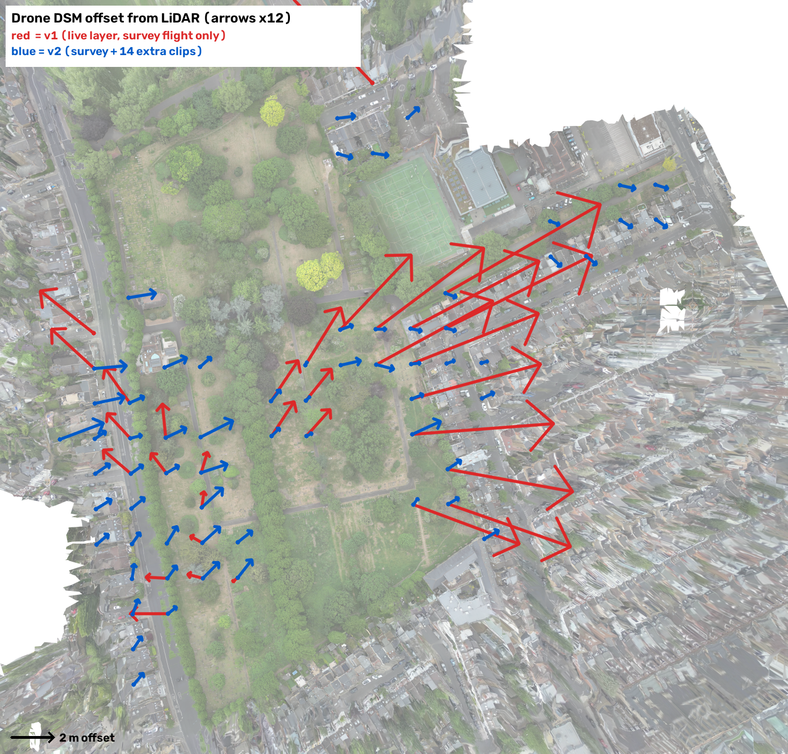

# Drone orthophoto base layer

The map's **Drone (May 2026)** base layer is a single, seamless, straight-down photo of the cemetery, stitched together from drone video footage. At about 3 cm per pixel it's much sharper than the Esri satellite imagery, and more recent. It lines up with Ordnance Survey and Environment Agency LiDAR data to within about half a metre, which is accurate enough for placing tree markers.

Link straight to it with `?drone=1`, the same way `?satellite=1` works.

## Source footage

- 86 DJI video clips filmed on 7 May 2026: 4K (3840×2160), 50 fps, HEVC, 24 mm-equivalent lens.
- Each clip has a sidecar `.SRT` subtitle file that records, for every frame, the time, GPS position, height above take-off (`rel_alt`), sea-level altitude (`abs_alt`) and camera settings. This is the overlay VLC shows. It does **not** record the gimbal (camera) angle.
- Most clips are low-level or angled shots. One clip, **DJI_0422**, is a 2.5-minute survey flight straight down at a constant 120 m, flown as parallel north–south lines with about 60 m between them. On its own it covers the whole cemetery.

The footage (39 GB) and the intermediate files are not kept in this repo, only the finished tiles and the scripts.

## Finding the right footage: the flight tracks map

Watching 50 minutes of 4K video to find the usable bits would have been slow. The telemetry gave a quicker way in: [**the flight tracks map**](https://trees.fulhamcemeteryfriends.org.uk/drone/tracks_map.html) (`drone/tracks_map.html`) draws every clip's flight path over satellite imagery.

- **Colour shows altitude**, from blue (ground level) to red (about 124 m).
- **Thin lines** are whole flights. **Thick lines** are *candidate segments*: stretches of at least 6 seconds where the drone held a steady altitude and was moving. That's the kind of flying that suits mapping.
- **Click any line** to see the clip name, the time in the clip, and the altitude. For a segment, you also get its duration, length and speed.
- **Only candidate segments** hides everything else. **Min altitude** hides anything lower than the slider.

Set the slider to about 100 m and the picture is clear. Most of the footage was shot below 30 m, which is good for close-ups but no use for a map. About ten clips flew at 105–120 m, and one of them, DJI_0422, shows as a set of parallel thick lines across the whole cemetery: a survey pattern. A quick look in VLC confirmed that the camera pointed straight down throughout, so DJI_0422 became the source for the orthophoto.

The map also showed where the other high passes flew. That was used later to find extra footage for the problem spots (see [Version 2](#version-2-extra-footage-for-problem-spots)).

Clips recorded before the drone had a GPS fix log their position as 0,0. These points are left out of the map: DJI_0438 (no fix at all) and the first 20 seconds of DJI_0439.

## Process

The layer was made in two rounds. Version 1 used the survey flight alone. Version 2 added footage from other clips for areas that came out smeared, and turned out to be far more accurately positioned too. Only version 2 is live.

### Version 1: the survey flight

1. **Read the telemetry** (`drone/parse_srt.py`). This parses every `.SRT` into a per-second CSV of position, altitude and speed, picks out the candidate segments, and generates the flight tracks map described above.
2. **Extract frames** (`drone/extract_frames.py`). This takes one frame every 10 m of ground travelled (about 90% overlap), choosing the sharpest of 5 nearby frames each time. Each frame is saved as a full-resolution JPG with the GPS position, altitude, time and focal length written into its EXIF (with [ExifTool](https://exiftool.org/)). DJI_0422 gave 86 frames.
3. **Make the orthophoto** with [OpenDroneMap](https://opendronemap.org/) (ODM), run in Docker. ODM matches the frames, rebuilds the ground and trees in 3D, and projects that model straight down. A simple panorama stitch can't do this, which is why trees don't lean away from the centre. The result is a georeferenced GeoTIFF.

   ```
   docker run --rm -v <work>/odm:/datasets opendronemap/odm --project-path /datasets cemetery --orthophoto-resolution 5
   ```

   With 86 frames this took 49 minutes on a 12-core PC with 16 GB of RAM. The result: all 86 images placed, 0.94 px reprojection error, and 4.3 cm/px ground resolution.

Version 1 looked good, but it had two problems:

- **Smeared spots**, mostly along walls, the boundary hedges and some trees, plus the outer edges of the image.
- **Position errors**, found later (see [Accuracy](#accuracy)): it was stretched by a few percent, putting things up to 2–3.5 m north of their true position.

### Version 2: extra footage for problem spots

1. **Mark the problems.** The smeared areas were painted red on a copy of the version 1 orthophoto. There were 29 spots.
2. **Find footage of them** (`drone/find_coverage.py`). This converts the red areas to coordinates and searches the telemetry of all the other clips for moments when the drone was roughly above them. It found 34 time ranges in 23 clips. Seven spots had no other footage.
3. **Choose by eye** (`drone/contact_sheets.py`). This makes a labelled thumbnail sheet for each time range. From those, 26 ranges in 14 clips were kept: clear views of the ground with no horizon, at heights from 17 m to 120 m.
4. **Extract frames** (`drone/extract_ranges.py`):
   - from the kept ranges, with spacing scaled to altitude (about 0.12 × height, so every 2.5 m at 20 m up and every 14 m at 120 m), giving 231 frames
   - from DJI_0422 again, denser, every 5 m, giving 167 frames
5. **Run ODM** with rolling-shutter correction (a video sensor reads out line by line, so moving frames are slightly skewed), higher matching and point-cloud quality, and a finer mesh (`drone/run_v2.sh`):

   ```
   docker run --rm -v <work>/odm:/datasets opendronemap/odm --project-path /datasets cemetery_v2 --rolling-shutter --feature-quality high --pc-quality high --mesh-octree-depth 12 --mesh-size 300000 --orthophoto-resolution 4 --dsm --dem-resolution 10
   ```

   With 398 frames this took 3.5 hours. The result: 397 of 398 images placed in one model, 0.96 px reprojection error, and **3.0 cm/px** ground resolution. `drone/compare_spots.py` makes side-by-side crops of two orthophotos at each problem spot.

6. **Correct and crop** (`drone/accuracy/prepare_v2.py`, run with the GDAL that comes with the ODM image). This crops to the cemetery and its surroundings and shifts the image by the measured −0.56 m east and −0.29 m north (see below).
   Then `drone/mask_to_cemetery.py` makes everything outside the cemetery transparent, so Esri shows there instead of the drone's smeared views of the surrounding streets. The outline is the app's section polygons, plus the west entrance drive, buffered by 15 m with a soft edge.
7. **Cut map tiles** with `gdal2tiles.py`, also included in the ODM image. It writes standard XYZ tiles (the same numbering Leaflet and OpenStreetMap use) as WebP at quality 80:

   ```
   docker run --rm --entrypoint gdal2tiles.py -v <work>:/w opendronemap/odm --xyz --zoom=15-21 --tiledriver=WEBP --webp-quality=80 --webviewer=none --resampling=lanczos /w/ortho_v2_masked.tif /w/tiles
   ```

   Fully transparent tiles outside the layer's `bounds` are then deleted, since Leaflet never requests them. The result is 1,399 tiles, 9.8 MB in total. A phone only downloads the few tiles on screen, typically a few hundred KB.

## Accuracy

The drone's GPS is only good to a couple of metres, and that's not good enough for placing tree markers. Both versions were therefore checked against independent references (issue #2):

- **Ordnance Survey OpenMap Local** building outlines (`drone/os-buildings.geojson`)
- the **Environment Agency National LIDAR Programme 2023 First Return DSM**, 1 m, tile TQ2075, flown January–March 2023

**Method** (`drone/accuracy/measure_offset.py`, `drone/accuracy/offset_field.py`):

- **Height models:** ODM built a height model (DSM) of each version.
- **Common grid:** each DSM was compared with the LiDAR on a 1 m British National Grid. Positions were converted with **OSTN15**, the official, 3 cm-accurate conversion. Without its grid file, pyproj silently uses a "ballpark" conversion that's metres out, so run `pyproj sync --file uk_os_OSTN15_NTv2_OSGBtoETRS.tif` first.
- **What's matched:** only features that stand tall in the **winter** LiDAR, i.e. buildings, walls and evergreens. Deciduous trees are almost invisible in it, but dominate the May drone data, so they're excluded.
- **Local windows:** the match is done in 40 m windows across the site. Only clear, unambiguous matches are kept, so the result shows whether the offset varies from place to place.

**Results** (drone layer position minus true position):

| | Median offset | Spread | Across the site |
|---|---|---|---|
| Version 1 | +1.1 m E, +1.5 m N | ±1–3 m | stretched: from ~0 m in the south to +2 m north at the north end |
| Version 2, before correction | +0.56 m E, +0.29 m N | ±0.2–0.4 m | uniform |
| **Version 2, live** | **0.0 m E, 0.0 m N** | ±0.2–0.4 m | uniform |



Version 2's small uniform offset is about what you'd expect from datums. The drone's GPS works in present-day WGS84. OS and LiDAR data use ETRS89, which is fixed to the European plate, and the two have drifted about 0.9 m apart towards the north-east since 1989. A constant shift was enough to remove it. The remaining ±0.2–0.4 m spread is about the precision of the method itself.

## In the app

In `index.html` the layer is a `L.layerGroup` of the Esri satellite tiles with the drone tiles on top:

- `tiles/drone-2026-05-v2/{z}/{x}/{y}.webp`, from zoom 15 to 21, which matches the app's `maxZoom`.
- A `bounds` setting with the tile set's extent, so Leaflet never asks for tiles that don't exist.
- Outside the cemetery, and when zoomed out below 15, Esri shows through.

Each new version goes into a new folder, so browsers don't mix old cached tiles with new ones. Version 1's tiles (`tiles/drone-2026-05/`) were removed when version 2 went live. They're still in the git history.

## Known issues

- **Seven problem spots had no extra footage.** These are the north-east strip beyond the sports ground and four spots by the west hedge in the south. They improved only from the better processing settings.
- **Tall, thin objects** such as the lodge steeple, and some tree edges, can still smear. These are the hardest case for this method.
- **Outer edges** of the drone image are rough where only one or two frames saw them. They're masked out, apart from a 15 m margin around the cemetery.

## Tools

- ffmpeg/ffprobe, for decoding video and extracting frames
- ExifTool, for writing GPS EXIF tags
- Python 3 with `opencv-python-headless`, `numpy`, `pyproj` and `rasterio`
- Docker Desktop with the `opendronemap/odm` image, which also includes GDAL and `gdal2tiles.py`
